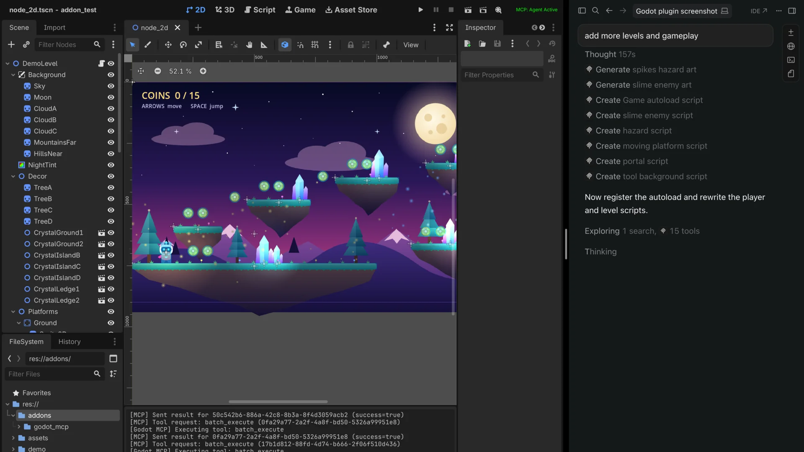

# Godot MCP

**Give your AI assistant full access to the Godot editor.**

Build games faster with Claude, Cursor, or any MCP-compatible AI — no copy-pasting, no context switching. AI reads, writes, and manipulates your scenes, scripts, nodes, and project settings directly.

> Godot 4.4+ · 69 tools · Undo/redo · Interactive project visualizer · MIT license

**Now on the [Godot Asset Store](https://store.godotengine.org/asset/tomer-yud/godlink/) as Godlink MCP.** If it helps you, please leave a review there. It's the main way other Godot developers find it.



---

## Quick Start

### 0. Install Node.js (one-time setup)

Download and run the installer from **[nodejs.org](https://nodejs.org/en/download)** (LTS version). It's a standard installer — no terminal needed.

### 1. Install the Godot plugin

**Godot 4.7 and newer:** inside the Godot editor, click the **Asset Store** tab at the top → search **"Godlink"** → find **"Godlink MCP"** → Install. ([Store page](https://store.godotengine.org/asset/tomer-yud/godlink/))

**Godot 4.6 and older:** click the **AssetLib** tab instead → search **"mcp"** → find **"Godot AI Assistant tools MCP"** → Install.

**Manual install:** copy the `addons/godot_mcp/` folder from this repo into your project's `addons/` folder.

Then go to **Project → Project Settings → Plugins** and enable the **Godot MCP** plugin.

### 2. Add the server config to your AI client

**Claude Desktop** — Settings → Developer → Edit Config → open the config file and paste:

Mac / Linux:
```json
{
  "mcpServers": {
    "godot": {
      "command": "npx",
      "args": ["-y", "godot-mcp-server"]
    }
  }
}
```

Windows:
```json
{
  "mcpServers": {
    "godot": {
      "command": "cmd",
      "args": ["/c", "npx", "-y", "godot-mcp-server"]
    }
  }
}
```

**Cursor** — Settings → MCP → Add Server:

Mac / Linux:
```json
{
  "mcpServers": {
    "godot": {
      "command": "npx",
      "args": ["-y", "godot-mcp-server"]
    }
  }
}
```

Windows:
```json
{
  "mcpServers": {
    "godot": {
      "command": "cmd",
      "args": ["/c", "npx", "-y", "godot-mcp-server"]
    }
  }
}
```

**Claude Code** — run in terminal:
```bash
claude mcp add godot -- npx -y godot-mcp-server
```

Works with any MCP-compatible client (Cline, Windsurf, etc.)

### 3. Restart your AI client

Close and reopen Claude Desktop / Cursor / your client so it picks up the new config.

### 4. Restart your Godot project

Hit **Restart Project** in the Godot editor. Check the **top-right corner** — once your AI client is running you should see **MCP: Agent Active** in green. You're ready to go.

If it shows **MCP: No Agent** in orange, Godot found the server but no AI client is using it yet. Restart your AI client. **MCP: Disconnected** in red means the server isn't running. Check that Node.js is installed and the config from step 2 is saved.

---

## What Can It Do?

### 69 Tools Across 7 Categories

| Category | Tools | Examples |
|----------|-------|---------|
| **Scene Operations** | 23 | Create whole node trees in one call, add/remove/move nodes, set any property including textures, shapes, meshes and materials (by file path or inline), attach scripts, signals, groups, call methods |
| **Project & Runtime** | 28 | Run/stop the game, send input, take screenshots, inspect live nodes, read errors and logs, project settings, input map, autoloads |
| **Script & File Operations** | 8 | Edit and validate scripts, write files, rename/move files with reference updates, create and delete folders |
| **File Browsing** | 4 | Browse directories, read files, search the project, create scripts |
| **Undo & Batching** | 4 | Undo/redo any AI change, run many changes as one all-or-nothing batch |
| **Asset Generation** | 1 | Generate 2D sprites from SVG |
| **Visualization** | 1 | Interactive browser-based project map and scene explorer |

### Interactive Visualizer

Run `map_project` and get a browser-based explorer at `localhost:6510`:
- Force-directed graph of all scripts and their relationships
- Click any script to see variables, functions, signals, and connections
- Edit code directly in the visualizer — changes sync to Godot in real time
- Scene view with node property editing
- Find usages before refactoring


### Limitations

AI cannot create 100% of a game by itself — it struggles with complex UI layouts, compositing scenes, and some node property manipulation. It's still in active development, so feedback is very welcome!

---

## Architecture

```
┌─────────────┐    MCP (stdio)   ┌──────────────┐   WebSocket   ┌──────────────┐
│  AI Client  │◄────────────────►│  MCP Server  │◄─────────────►│ Godot Editor │
│  (Claude,   │                  │  (Node.js)   │   port 6505   │  (Plugin)    │
│   Cursor)   │                  │              │               │              │
└─────────────┘                  │  Visualizer  │               │  69 tool     │
                                 │  HTTP :6510  │               │  handlers    │
                                 └──────┬───────┘               └──────────────┘
                                        │
                                 ┌──────▼───────┐
                                 │   Browser    │
                                 │  Visualizer  │
                                 └──────────────┘
```

---

## Current Limitations

- **Local only** — runs on localhost, no remote connections
- **One Godot editor at a time** — multiple AI clients can connect concurrently, but they all share a single Godot instance
- **Ctrl+Z does not reach AI changes** — the plugin writes to disk rather than the editor's live tree, so Godot's native undo has nothing to revert. Use the `mcp_undo` tool instead (ask the agent to undo).
- **AI is still limited in Godot knowledge** — it can't create 100% of the game alone, but it can help debug, write scripts, and tag along for the journey

---

## Development

To build from source instead of using npm:

```bash
cd mcp-server
npm install
npm run build
```

Then point your AI client at `mcp-server/dist/index.js` instead of using `npx`.

---

## Release notes

Narrative write-ups of each release live in [`release-notes/`](./release-notes/) (latest: [v0.6.1](./release-notes/v0.6.1.md)). For the full change history, see [`CHANGELOG.md`](./CHANGELOG.md).

---

## License

MIT

---

## Star History

<a href="https://www.star-history.com/?repos=tomyud1%2Fgodot-mcp&type=date&legend=top-left">
 <picture>
   <source media="(prefers-color-scheme: dark)" srcset="https://api.star-history.com/chart?repos=tomyud1/godot-mcp&type=date&theme=dark&legend=top-left" />
   <source media="(prefers-color-scheme: light)" srcset="https://api.star-history.com/chart?repos=tomyud1/godot-mcp&type=date&legend=top-left" />
   
 </picture>
</a>

---

**[Godot Asset Store](https://store.godotengine.org/asset/tomer-yud/godlink/)** · **[npm package](https://www.npmjs.com/package/godot-mcp-server)** · **[Report Issues](https://github.com/tomyud1/godot-mcp/issues)**
